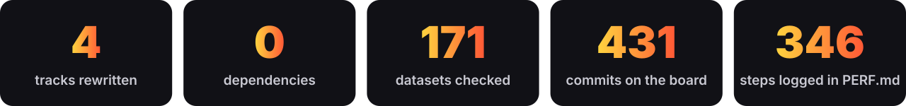
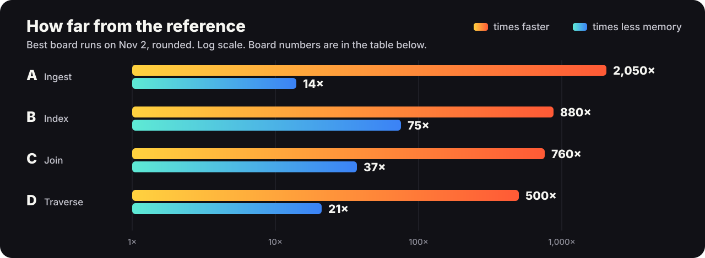
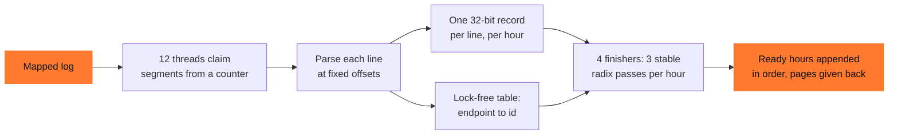
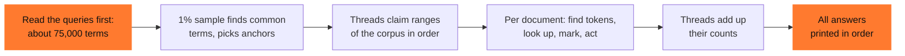
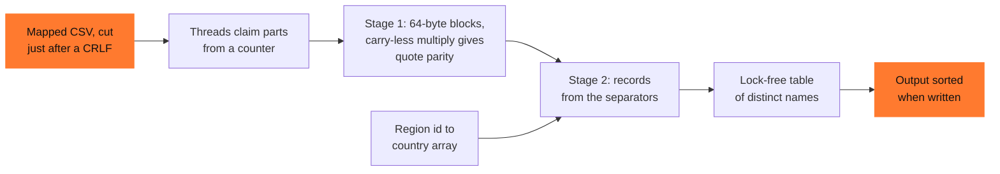
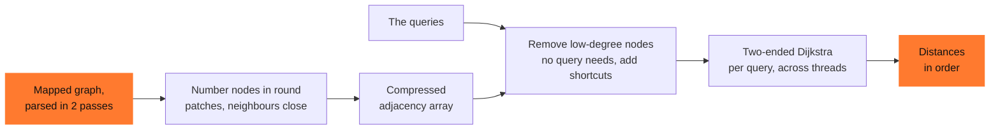
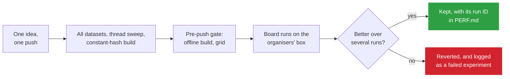
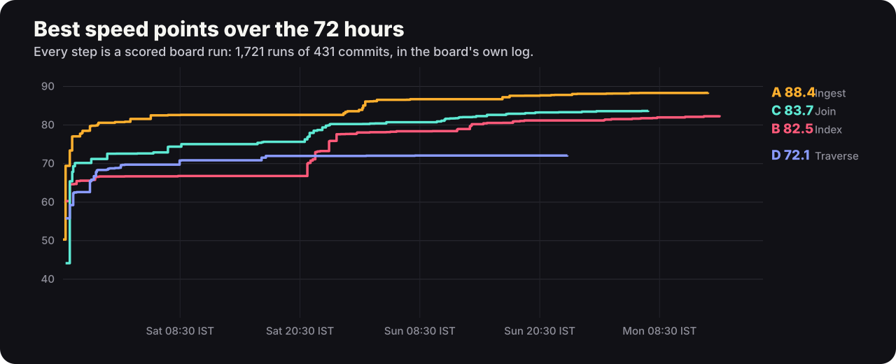

# ALL STAR · Speed Demon 2026

<div align="center">


<br>


**[The tracks](#the-tracks)** · **[The score](#how-the-score-works)** · **[Designs](#how-each-one-works)** · **[Board numbers](#board-numbers)** · **[Check our claims](#check-our-claims)** · **[Limits](#limits)** · **[What we have not verified](#what-we-have-not-verified)**

</div>

<br>

Four rewrites of the organisers' naive Python references, one per track. Each is written in Rust with only the standard library (zero dependencies) and built offline into its own Docker image. A solo entry by Saud Satopay.

Each track's output is compared byte for byte (SHA-256) with the reference's by one command ([below](#check-our-claims)). It covers 171 datasets, plus five repeated runs of each track.

<div align="center">

</div>

<div align="center">

</div>

## The tracks

<table>
<tr>
<td width="50%" valign="top">

### 🪵 A · Ingest
Per-hour, per-endpoint latency percentiles over a 3.1M-line request log.

**Reference on the box:** 32.05 s · 228 MB · 56 lines<br>
[README](track-a/README.md) · [PERF.md](track-a/PERF.md)

</td>
<td width="50%" valign="top">

### 🔎 B · Index
Boolean and phrase queries over a 254 MB corpus of 250,000 documents.

**Reference on the box:** 56.35 s · 2,200 MB · 91 lines<br>
[README](track-b/README.md) · [PERF.md](track-b/PERF.md)

</td>
</tr>
<tr>
<td width="50%" valign="top">

### 🔗 C · Join
A hostile 200 MB CSV joined to a region table and summed in integer cents.

**Reference on the box:** 14.44 s · 367 MB · 108 lines<br>
[README](track-c/README.md) · [PERF.md](track-c/PERF.md)

</td>
<td width="50%" valign="top">

### 🧭 D · Traverse
2,000 shortest paths on a directed graph of 1.74M nodes and 5M edges.

**Reference on the box:** 72.69 s · 893 MB · 43 lines<br>
[README](track-d/README.md) · [PERF.md](track-d/PERF.md)

</td>
</tr>
</table>

T is wall time, M peak memory and S the code lines the board counts, all as the board measures them. K and speed points are the board's own scores for a run; each PERF.md explains how M and S enter them.

## How the score works

Each track's speed score comes from one number, K, which compares a run with the naive reference on the same machine:

```text
K = (T_ref / T)^0.50 × min(M_ref / M, 50)^0.20 × min(S_ref / S, 1)^0.15 × (D_ref / D)^0.15

speed points = 50 × log10(K)
```

| Axis | What it measures | Weight | What that means here |
|---|---|---:|---|
| **T** | Wall time, the mean of the middle 3 of 5 runs | 0.50 | Half the score, with no cap. Every 2× is worth the same 7.5 points |
| **M** | Peak memory, the worst of 5 runs | 0.20 | Counts up to 50× better than the reference, so on Track B anything under 44 MB scores the same |
| **S** | Code lines, after the organisers' formatter | 0.15 | Larger than the reference costs, so every line has to earn its place |
| **D** | Dependencies | 0.15 | Zero extra dependencies costs nothing, and we use none |

A wrong byte in any output scores that track zero. Speed is 65% of a track's total; judges score the other 35% on code quality, technique and the optimisation log.

## How each one works

<details>
<summary><b>A · Ingest:</b> parse in place, finish each hour as soon as the reading has passed it</summary>



**Why it's fast**

- **No date parsing and no objects per line.** The reference spends about 77% of its time in `strptime`, and 228 MB on Python ints. Here the hour is one multiply of an 8-byte load, and a line is one 32-bit integer whose plain order is the order the percentiles need.
- **Mapping the log, with a prefetch per line and a shared release.** The parse reads the log's pages in place, with no copy into a buffer. Mapping lost to reading in pieces three times, because the clock runs to exit and exit took the log's pages down on one thread.
- **Hours finished during the read.** Memory peaks when records and text are both held. Finishing an hour as soon as the reading is past it took M from 18.8 to 16.4 MB, and T from 0.0245 to 0.0221, because no thread sits waiting for the output stage.
- **Almost no slow paths per line.** Keys sit in whole 64-byte lines, so one block compare settles 92% of lines, with no branch on the length of a key that fits. Before this, 13.7% of lines took the slow path; now 8.4% do.
- **Three linear passes per hour.** A record holds an endpoint id, a latency and an error flag. Two radix passes over the latency and one over the ids, in the endpoints' byte order, leave each endpoint's latencies sorted, with no comparison sort except for the side list of big latencies, below.
- **Text written over its own records.** The hour's array has room for its text, so an hour's text takes few new pages: on seed 1 it runs past its records in 30 of 72 hours, by 63 KB at most.

More: [approach and limits](track-a/README.md) · [every step and failed experiment](track-a/PERF.md)

</details>

<details>
<summary><b>B · Index:</b> no postings stored, one scan answers every query</summary>



**Why it's fast**

- **Only the queries' terms are indexed.** The reference builds a set for each of 609,833 terms. Here a token that no query uses costs one lookup and nothing else.
- **No posting is stored.** Queries with rare anchors are answered at those anchors, and the rest by blocks of documents, over bits that a thread reuses for each block. That took M from 42 to 27 MB locally, which scored nothing, as M was already under the 44.0 MB where more savings stop counting.
- **Stages per document, with no branch per token.** Token edges come from 64-byte masks and a table per byte; keys and hashes of four tokens at a time in AVX2; every token's set compared in a loop so short that the cache misses overlap, with no prefetch of the sets. Going from a token at a time to this took T from 0.308 to 0.211 s, then with fewer instructions per token to 0.100 s, and without postings and with stamps to 0.078 s.
- **Truth tables instead of formulas.** A BOOL check packs the marks of up to five other terms into a number, whose bit in a 32-bit table says whether the document counts. Three terms take 8 bytes, which covers 27,994 of the 31,615 checks on seed 1.
- **Marks that never need clearing.** A mark is a byte equal to the document's number in its block, so a new document sees none of the last one's, and a block's end clears them all.
- **Phrases check only around their rarest term.** No positions are stored, and most tokens trigger no check.
- **A count, a sum and the smallest ids come straight from the scan.** The reference sorts every result set. Block queries use nibble tables in AVX2 for counts and sums of positions in one pass.

More: [approach and limits](track-b/README.md) · [every step and failed experiment](track-b/PERF.md)

</details>

<details>
<summary><b>C · Join:</b> two stages over a hostile CSV, one shared table of names</summary>



**Why it's fast**

- **No chain from record to record.** A parser that finds each field from the end of the last is limited by that chain of loads, about 75 cycles per record here, not by its instruction count. Listing separators from fixed blocks breaks it.
- **No branch for most of the hostile parts.** Quote parity comes from arithmetic, so `""` pairs, commas in quotes and LFs in quotes need no branch. Mispredicts were 0.33 per record when last counted (local, PERF.md D58).
- **Three numbers in one vector,** and an amount's point skipped by its weights: a saturating subtract turns the sign and the point into zero digits.
- **A mapped file, and its pages released together.** A copy of the file would take as long as much of the parse, so the threads read it where it lies. When they're done they give its pages back between them: without that, T was 0.0228 on the board against 0.0192, because the exit released the pages on one thread (PERF.md, journey steps 119 and 120).
- **One cache line per name lookup,** guessed from the tags and prefetched for ownership before the locked write. A single `LOCK BTS` finds the country's bit.
- **No page charged from a worker's CPU.** `memory.peak` counts each CPU's unused charge batch, up to 252 KB per CPU that charges anything, so this took M from 12.9 to 10.6 MB on the board (journey steps 24 and 25).
- **No std runtime before `main`,** which saves about 15 system calls that the timer counts.

More: [approach and limits](track-c/README.md) · [every step and failed experiment](track-c/PERF.md)

</details>

<details>
<summary><b>D · Traverse:</b> renumber and simplify the graph, then search from both ends</summary>



**Why it's fast**

- **Two-ended search.** The reference searches from the source only, so it settles everything closer than the target.
- **Sides alternate by work, not by the smaller top.** Queries from a small island, and queries to a target nothing reaches, finish after a few settles rather than crossing the whole main body.
- **Neighbours close in memory.** The input's ids are random, so renumbering takes the queries from about 190 ms to about 105 ms.
- **Batched build.** A batch of edges prefetches its cache lines and lets them arrive together.
- **Fewer nodes to search.** Removing low-degree nodes with shortcuts took T from 0.166 to 0.152 s and M from 67.9 to 46.0 MB on the board (steps 17 to 19), and removing it now costs 9% of K (step 27).
- **A coarse radix queue.** Keys never go below the last block popped, so a key moves a few times in all, with no comparisons against other keys, and nothing sorts inside a block. Local counts fell from 1,202 to 1,154 instructions and from 7.32 to 5.88 mispredicts per edge (D17).
- **Search state sized to the search.** Labels live in 64-node pages, found through a u16 directory. A median search stays in the fastest caches, and the largest fills about 585 KB.

More: [approach and limits](track-d/README.md) · [every step and failed experiment](track-d/PERF.md)

</details>

## How a change reached the board



## The 72 hours

<div align="center">

</div>

## Board numbers

This table is refreshed from the board; the chart above is a rounded snapshot of it. The numbers come from the live board's feed at **2026-11-02 14:45:18 UTC (Mon 20:15 IST)** and the board's run history, and none is a local timing. Ranks are by K among the teams scored on that track at that time. Each row is the track's best scored run so far; the last column shows the latest run, to show how much one source moves between runs.

| Track | Best run | Commit | T (s) | M (MB) | S | K | Speed points | Rank by K | Latest run: K |
|---|---|---|---|---|---|---|---|---|---|
| A | `run-a3d80d9d43be` | `c438b24` | 0.0156 | 16.1 | 343 | 58.58 | 88.4 | 3 of 133 | 58.24 (`run-6cadaf29bbe1`) |
| B | `run-4d59d4dfba18` | `4d9e164` | 0.0643 | 29.2 | 1076 | 44.70 | 82.5 | 2 of 102 | 43.60 (`run-d224ac60ff4d`) |
| C | `run-d8ffdb6e4d14` | `ba16c53` | 0.0189 | 10.0 | 367 | 47.28 | 83.7 | 6 of 110 | 46.33 (`run-3a6c8f697d8b`) |
| D | `run-ba733dba1abf` | `f579765` | 0.1444 | 42.2 | 620 | 27.68 | 72.1 | 15 of 112 | 27.22 (`run-10b8011d566a`) |
| Overall | | | | | | | 84.84 | 3 of 109 | |

The overall row is the board's: speed points only, over the 109 teams with three scored tracks. The judges' share of the score comes after the freeze.

A best run can come from an earlier commit than the head of this branch; the commit column says which. The headline at the top of a PERF.md can lag this table until the freeze. Where they differ, this table is newer. Every step in a PERF.md names the board run that measured it, and the failed experiments are kept too.

## Check our claims

| Claim | How to check it |
|---|---|
| Every output matches the naive reference byte for byte | `python3 tools/verify.py`. It needs Docker, git and Python 3.9 or later, and took about 16 minutes from cold on our PC. It runs the organisers' own generators and reference on 15 seeds at 2 scales (120 datasets across the four tracks), 32 answer-preserving rewrites, 19 limit cases, and 5 repeated runs per track ([tools/README.md](tools/README.md)) |
| The times and memory above | The run IDs, on the board and in each PERF.md |
| Zero dependencies | Each track's `Cargo.toml` has an empty `[dependencies]` |
| Nothing is precomputed | Each program reads only the data directory it is given (`/data` by default), and final scoring uses a seed nobody has seen |

## Limits

One line per track. The full list is in each track's README, under Limits.

- **A** relies on the spec's guarantees: 27-byte timestamps inside the fixed 72-hour window, well-formed lines, and 1,842 endpoints. Outside them it aborts, or can count a line in the wrong hour. A line that comes later than 1/48 of the log restarts the run, which about doubles T; no generated seed does this. Its T has a slow mode on identical code that we can't fully explain.
- **B** relies on document ids that run consecutively from 0, and on at most 6 terms in a BOOL query and 8 in a phrase. Its sums of ids keep 40 bits, which holds up to 1,482,910 documents, and nothing checks for more. The spec's full scale has 250,000. It is also the longest of our tracks.
- **C** relies on sections 2.2 and 2.3 of the spec: how a BOM and a CR can appear, numbers that fit in 8 bytes, at most 240 countries, and a last record that ends in CRLF. A name over 32 bytes takes a slower path. It calls PEXT, BZHI, carry-less multiply, PREFETCHW and GFNI directly, so it only runs on a CPU that has them, as the scoring box's does.
- **D** stops at an assertion if the graph keeps more than 4.19M nodes after simplifying; the full-scale graph has 1.74M before. Its code has not changed since Nov 1, and its numbering can differ a little between runs, which costs time and never a wrong answer.
- **All four** are built for x86-64-v3 (AVX2) on Linux with glibc, and are timed only on the organisers' box.

## What we have not verified

- **Other hardware.** Timings that count come from the board's box. Our own PC (a Zen 4 7600X) ranked candidate builds and was not used for any figure above. Nothing was run on other CPUs.
- **Slow runs.** On the board, A shows a slow mode on identical code, and C has shown one in about 1 run in 10 since Nov 1. For C, we think it is box noise but haven't proven it.
- **Sanitizers.** Address and thread sanitizers ran on an earlier build of A, not its final one. The thread sanitizer reported things we believe are false alarms but haven't all examined.
- **Late lines in A.** The restart path for a late line is exercised only by logs we built by hand, since no generated seed triggers it.
- **A file with no final terminator in C.** It would lose its last record, and none of our test files has one. The spec rules it out.
- **Phase timings.** Where B and A lose time on the box was measured on earlier designs. We haven't timed the current ones that way.
- **This table.** It is a snapshot. Ranks and K move with every run by anyone, and we make no claim about the final ranking.
- **The check report.** `tools/verify.py` writes its report to `.out/`, which is not committed, so the claim above can be reproduced but isn't shown here.

## How we worked

<details>
<summary>Show</summary>

- **Correct first.** A bank of datasets ran on every build: generator seeds, answer-preserving rewrites of them (line endings, BOMs, quoting, order) and synthetic files at each spec's limits. It ran natively in seconds, then in the board's sandbox. A pre-push gate was set up to refuse a push that failed its Dockerfile check, its offline build or the correctness grid.
- **Measured like the box.** The local scorer uses the organisers' timer from exec to exit, cgroup `memory.peak`, a trimmed mean of repeated runs, and the box's huge-page setting. Local numbers only ranked candidate builds, and `ab.sh` counted a change only if it beat twice the run-to-run spread.
- **One idea per push,** so each board run measures one change. The dev machine is WSL2 with no hardware counters, so instruction and branch-miss counts come from cachegrind, and are cited in the PERF.md entries.


</details>

## Shared design choices

<details>
<summary>Show</summary>

- **Rust, standard library only.** Each image builds on `rust:1-slim-trixie`, pinned by digest, with `cargo build --release --offline`. A, B and D run on `debian:13-slim` in a second stage; C has one stage and runs where it was built. `mmap`, `madvise` and a few other calls are declared by hand against glibc, which `std` already links, so there is no `libc` crate.
- **Threads.** The count is `SD_THREADS` if set, otherwise `available_parallelism()`, which respects the container's CPU set, capped at 12. A, B and D use `std::thread::scope`; C creates its threads with `pthread` calls it declares itself. Work is handed out from atomic counters.
- **Build flags** are in each track's `.cargo/config.toml`: `target-cpu=x86-64-v3` on all four. A, B and C also link glibc statically, as T counts from exec, and switch off three tuning features meant for much older CPUs. C adds `pclmulqdq`, `prfchw` and `gfni`.
- **One output file.** Each program writes exactly one file into `/out` (`summary.txt`, `results.txt`, `aggregates.txt` or `distances.txt`), in pieces.


</details>

## Before the event

<details>
<summary>Show</summary>

Reading the specs against the harness source turned up two places where the docs and the code disagreed: the dataset the board uses for Track B, and the final-scoring timeout. We reported both on Discord, and the organisers fixed them the same day ([da9d695](https://github.com/hackathon-raptors/speed-demon-2026/commit/da9d695)). No solution code was written before kickoff. `tools/` is test tooling outside the track folders, as the rules allow.

Our first push came 4 minutes 50 seconds after kickoff. GitHub's activity log shows the repo unchanged from the starter until then (15:04:50 UTC, commit `90b27c9`). The session log shows the first Rust source written at 15:02:45 UTC. What existed before kickoff was prose design notes, test tooling, and build files with no track logic (`Cargo.toml`, `.cargo/config.toml`, the `Dockerfile`), which rule 05 allows. An AI agent wrote v1 from those notes. We can share the full session log with the organisers.


</details>

## AI use

Written with AI assistance (Claude Code and Codex (GPT-6 Luna)). The author directed the work and followed its results on the board; board numbers carry run IDs that anyone can check.

## Licence

MIT: see [LICENSE](LICENSE).
